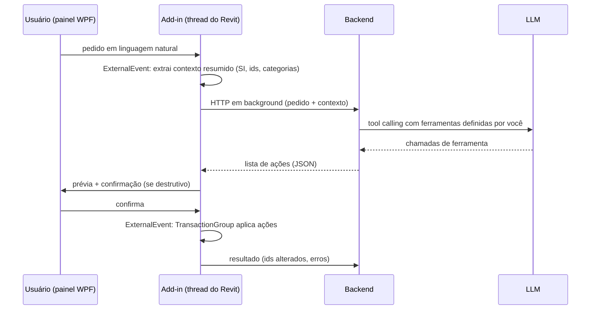

# Threading e integração com backend, LLM e MCP

O ponto que mais quebra add-ins que chamam serviços externos.

## A regra

Da página [Deployment Options](https://help.autodesk.com/view/RVT/2027/ENU/?guid=Revit_API_Revit_API_Developers_Guide_Introduction_Getting_Started_Using_the_Autodesk_Revit_API_Deployment_Options_html): a API só aceita chamadas **na thread principal do Revit**, dentro de um ponto de entrada que o próprio Revit chamou (comando, evento, `ExternalEvent`). O add-in não pode manter outra thread chamando a API quando quiser.

Na prática:

- Uma chamada HTTP pode e deve rodar fora da thread principal, para a UI não travar.
- O que vem depois do `await` **não** pode tocar na API se estiver rodando numa thread do pool. Ler um parâmetro ali também é proibido, não só alterar.
- Nunca bloqueie a thread principal esperando uma tarefa (`.Result`, `.Wait()`, `.GetAwaiter().GetResult()`): se essa tarefa depende de um `ExternalEvent`, o Revit trava em deadlock.

## ExternalEvent: o mecanismo oficial

Fonte: [External Events](https://help.autodesk.com/view/RVT/2027/ENU/?guid=Revit_API_Revit_API_Developers_Guide_Advanced_Topics_External_Events_html).

1. Implementar `IExternalEventHandler` (`Execute(UIApplication)` e `GetName()`).
2. Criar o evento com `ExternalEvent.Create(handler)`, num contexto válido da API (por exemplo, dentro de um comando ou do `OnStartup`).
3. De qualquer lugar (janela não modal, callback HTTP), chamar `externalEvent.Raise()`.
4. O Revit chama `Execute()` no próximo ciclo ocioso (Idling), na thread principal. Ali dá para abrir transações.

```csharp
public class AplicarAcoesHandler : IExternalEventHandler
{
    private readonly ConcurrentQueue<AcaoDoModelo> _fila = new();

    public void Enfileirar(AcaoDoModelo acao) => _fila.Enqueue(acao);

    public void Execute(UIApplication app)
    {
        var doc = app.ActiveUIDocument.Document;
        while (_fila.TryDequeue(out var acao))
        {
            using var t = new Transaction(doc, acao.Descricao);
            t.Start();
            acao.Aplicar(doc);
            t.Commit();
        }
    }

    public string GetName() => "Aplicar ações do assistente";
}
```

Observações do guia e da prática:

- `Raise()` volta na hora; a execução acontece depois. Se precisa do resultado, use uma `TaskCompletionSource` que o handler completa, e aguarde com `await` (nunca com `.Result`).
- O dono da janela deve dar `Dispose()` no `ExternalEvent` ao fechar.
- Se o Revit estiver num modo de edição ou com outro comando ativo, o evento espera.
- Exemplo completo no SDK: `ModelessDialog\ModelessForm_ExternalEvent`.

### Atalho: Nice3point.Revit.Toolkit

O pacote [Nice3point.Revit.Toolkit](https://github.com/Nice3point/RevitToolkit) (incluído nos templates) já embrulha esse padrão:

- `AsyncRequestExternalEvent<T, TResult>`: `await evento.RaiseAsync(arg)` devolve o resultado calculado na thread do Revit.
- `AsyncExternalCommand`: comando com `ExecuteAsync()`, que mantém a UI responsiva durante o `await`.
- Os eventos podem ser criados em qualquer thread, sem precisar de contexto da API.

O próprio README avisa: aguarde sempre com `await`; bloquear a thread principal num evento pendente causa deadlock. O handler continua síncrono: faça a E/S assíncrona antes ou depois de disparar o evento.

## Padrão recomendado: plugin como cliente fino



Cada passo que toca o modelo (extrair contexto, aplicar ações) é um `ExternalEvent`; cada passo de rede roda fora da thread principal.

## Servidor MCP local

Desde o Revit 2025.1 o Revit tem referência de framework para `Microsoft.AspNetCore.App` (What's New 2025), então o add-in pode subir um Kestrel em `localhost` sem empacotar o ASP.NET Core.

Arquitetura:

- `OnStartup` sobe o servidor HTTP em background (porta local, só `127.0.0.1`).
- Cada ferramenta MCP recebida vira um `ExternalEvent` com resultado (`TaskCompletionSource` ou `AsyncRequestExternalEvent`), que lê ou altera o modelo e devolve JSON.
- `OnShutdown` derruba o servidor.

Cuidados:

- Com isolamento de dependências desligado, outro add-in pode carregar versões diferentes das DLLs do servidor. Ligue `UseRevitContext=False` (2026+).
- Exija um token mesmo em `localhost`: qualquer processo da máquina consegue chamar a porta.
- O modo MCP serve para prototipar e para usuários avançados (Claude Desktop, Cursor). Para monetizar, o fluxo principal deve passar pelo seu backend.

## Rede, TLS e proxy

Da página [Transport Layer Security](https://help.autodesk.com/view/RVT/2027/ENU/?guid=Revit_API_Revit_API_Developers_Guide_Advanced_Topics_TransportLayerSecurity_html):

- Não configure TLS no add-in para TLS 1.0–1.2: o Revit já resolve.
- **Nunca** atribua `ServicePointManager.SecurityProtocol = SecurityProtocolType.Tls12;`: isso sobrescreve a configuração do Revit e quebra a comunicação dele com os serviços da Autodesk. Se for preciso, some com OR: `ServicePointManager.SecurityProtocol |= SecurityProtocolType.Tls12;`.

Não está no guia, mas é necessário em escritório:

- `HttpClient` com `HttpClient.DefaultProxy` / `WebRequest.DefaultWebProxy` e credenciais padrão do Windows (proxy corporativo).
- Tempo limite e tratamento de falta de conexão; o Revit não pode ficar travado esperando a rede.
- Um único `HttpClient` (ou `IHttpClientFactory`) por add-in, não um por chamada.

## Janelas e diálogos

- Use `UIApplication.MainWindowHandle` (ou o de `UIControlledApplication`) como dono de janelas WPF e diálogos modais, não `Process.GetCurrentProcess().MainWindowHandle`, que o guia diz não ser confiável ([Window Handle](https://help.autodesk.com/view/RVT/2027/ENU/?guid=Revit_API_Revit_API_Developers_Guide_Advanced_Topics_Window_Handle_html)).
- Para chat ou listas persistentes, prefira painel encaixável ([03-anatomia-do-addin.md](03-anatomia-do-addin.md)).
- UI web dentro do add-in: WebView2. O Revit 2026 removeu o CefSharp.

## Segurança e privacidade (decisões de arquitetura)

- Nenhuma chave de LLM na DLL: assemblies .NET se descompilam com facilidade. A DLL só conhece o seu backend.
- Login do usuário com OAuth (PKCE ou device code); token guardado no Windows Credential Manager.
- Mandar só o necessário: ids, categorias, parâmetros relevantes e medidas em SI. Nunca o arquivo `.rvt`.
- Registrar no backend o que foi enviado, para responder a perguntas de LGPD e de contrato.
