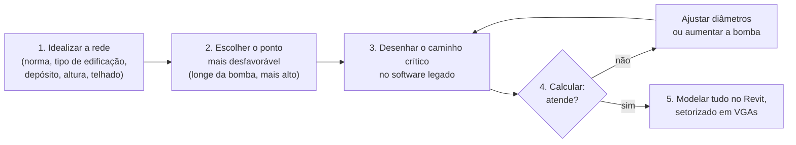
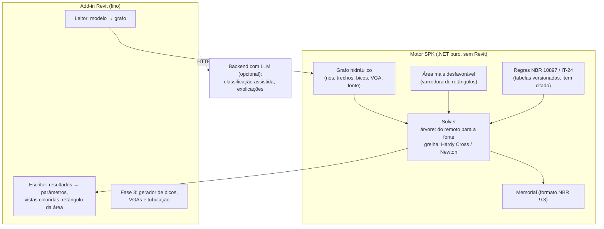

# Refinamento — SPK (chuveiros automáticos) no Revit

Status: rascunho para validar com o Ciroca. Fontes usadas: as mensagens e o [áudio dele](transcricao-ciroca.md), as duas imagens do projeto (planta da malha e mapa de VGAs), a ABNT NBR 10897:2020 e a IT-24/2019 do CBPMESP (pasta `plugin-inicial-arquivos/`).

> As normas ABNT são protegidas por direito autoral. Este documento e o produto citam **itens e tabelas**, nunca reproduzem o texto. O PDF da NBR está no `.gitignore` (é licenciado para a USP).

## 1. Resumo

O fluxo do projetista hoje tem três ferramentas e dois redesenhos: ele idealiza a rede pela norma, **redesenha só o caminho crítico** num software legado (Windows XP) para calcular, itera até passar e depois **modela tudo de novo** no Revit, setorizado em VGAs.

O produto proposto elimina os redesenhos: **o cálculo hidráulico roda sobre o próprio modelo Revit**, com as regras da NBR 10897 e da IT-24 embutidas, e a busca da área mais desfavorável é automática. Numa segunda fase, o plugin também **gera** o layout de bicos, a setorização em VGAs e a tubulação.

Ressalva importante: "pouca automação no Revit" não é bem verdade no mercado global. Já existem add-ins de cálculo de sprinkler dentro do Revit (seção 6). A lacuna real é **norma brasileira + IT do Corpo de Bombeiros + memorial em português + preço em reais**, e a geração automática do traçado.

## 2. O fluxo atual (como o Ciroca descreveu)

Dores que aparecem nesse fluxo:

| Etapa | Dor |
|---|---|
| 2 | O ponto crítico é escolhido "no olho". Em grelha, a própria NBR (9.4.4.4.2) exige mais dois cálculos de áreas vizinhas, a não ser que um programa confirme que a área escolhida é a pior. |
| 3 | Redesenho manual de uma parte da rede: retrabalho e risco de divergência entre o que foi calculado e o que foi modelado. |
| 4 | Cada iteração exige voltar ao software legado. Mudou o layout no Revit, o cálculo fica desatualizado sem ninguém perceber. |
| 5 | Modelagem de centenas de bicos, ramais e subgerais à mão (a planta de exemplo tem centenas de bicos por VGA). |
| Geral | Software de XP: sem suporte, difícil de instalar, sem integração BIM, relatório fora do padrão do CB. |

## 3. Conceitos do domínio (glossário)

| Termo | O que é | Onde na norma |
|---|---|---|
| SPK | Sistema de chuveiros automáticos (sprinklers). | NBR 10897 |
| Bico / chuveiro | O sprinkler. Caracterizado pelo **fator K** (vazão Q = K·√P), temperatura, resposta (padrão/rápida), tipo (spray em pé, pendente, lateral, cobertura estendida, CCAE, ESFR). | NBR 5.2, Tab. 1 e 2 |
| Classe de risco | Leve, ordinário (grupos 1 e 2), extraordinário (grupos 1 e 2), armazenamento. Define densidade × área de operação. | NBR seção 4 e 8.3; exemplos no Anexo A |
| Ramal | Tubo que alimenta diretamente os bicos. | NBR seção 3 |
| Subgeral | Tubo que alimenta os ramais. | NBR seção 3 |
| Geral / coluna | Alimenta as subgerais; a coluna principal sobe até a VGA. | NBR seção 3 |
| **VGA** | Válvula de governo e alarme: cada uma controla **um setor** (uma malha). | NBR 7.3, Tab. 8 |
| Área de operação | A área que se supõe em incêndio ao mesmo tempo (o "10×10 de sprinklers" do áudio). Vem das curvas de densidade-área. | NBR 8.5.2, Fig. 42 |
| Área mais desfavorável | A área de operação com **maior demanda hidráulica**; se ela passa, o sistema passa. | NBR 9.4.4.1, Fig. 45 a 47 |
| Espinha de peixe / grelha / anel | Topologias de rede. Espinha de peixe é uma árvore; grelha e anel têm malhas (loops) e exigem um solver iterativo. | NBR 9.4.4.4 |
| ESFR | Chuveiro de supressão rápida, muito usado em depósitos altos; dimensionado pela IT-24 com número fixo de bicos, não por densidade-área. | NBR Tab. 14 e 26; IT-24 |

### Por que existem vários VGAs

A NBR (7.3, Tabela 8) limita a área que **uma coluna/válvula** pode atender por pavimento: **4 800 m²** para risco leve ou ordinário por cálculo hidráulico e **3 700 m²** para extraordinário ou armazenamento. Áreas maiores obrigam a dividir em setores. É exatamente o que aparece no mapa de setorização: cinco VGAs seguindo as linhas da estrutura.

## 4. O que a norma pede do cálculo (o "motor")

Tudo isso é **determinístico**. Não precisa de IA, e não deveria ter: é cálculo de engenharia que precisa ser auditável.

1. **Classificar a ocupação** (NBR 4 e 8.3; para depósitos, a IT-24 com classe de mercadoria I a IV, plásticos grupo A/B/C, altura de armazenagem, tipo de estocagem: pilha, palete, porta-paletes, prateleiras).
2. **Escolher a base de projeto**:
   - risco leve/ordinário/extraordinário: método de densidade e área (NBR 8.5.5, Fig. 42) ou por recinto (8.5.6);
   - depósitos: tabelas e curvas da IT-24 (densidade-área para controle; número de bicos e pressão mínima para ESFR/CCAE).
3. **Ajustar a área de operação**: mínimos de 140 m² ou 230 m² (8.5.4); redução por resposta rápida (8.5.5.3, Fig. 43, mínimo de cinco bicos); +30 % em teto inclinado acima de 16,7 % (8.5.5.4); +30 % em ação prévia com bloqueio duplo (8.5.5.5); −25 % com bico de alta temperatura em risco extra (8.5.5.6). Os ajustes são cumulativos sobre a área original (8.5.5.7). A IT-24 tem regras próprias (5.1.8).
4. **Posicionar a área de operação** (9.4.4.2): retangular, com o lado paralelo aos ramais ≥ 1,2·√A, incluindo bicos dos dois lados da subgeral, arredondando frações de bico para cima (Fig. 46).
5. **Calcular a partir do bico mais remoto** (9.4.4.6): cada bico tem que entregar pelo menos densidade × área coberta pelo bico; a vazão vem da pressão real naquele bico (Q = K·√P).
6. **Perda de carga** por Hazen-Williams (9.4.2.1) com o C da Tabela 30 (por exemplo, aço preto molhado 120, galvanizado 120, CPVC 150), comprimentos equivalentes de conexões e válvulas (do fabricante, 9.4.3.4), desnível geométrico e as regras de quais tês e cotovelos entram (9.4.4.7 a–j). Pressão de velocidade e pressão normal são opcionais (9.4.2.1.2 e 9.4.4.9).
7. **Balancear os nós** com tolerância de 1 kPa, levando adiante a maior pressão (9.4.3).
8. **Verificar limites**: pressão mínima de 48 kPa em qualquer bico (9.4.4.10); máxima de 1 210 kPa em risco extra (9.4.4.11); diâmetro mínimo DN 25 em aço e DN 20 em cobre/plástico (9.4.1.2).
9. **Somar hidrantes** (8.5.1, Tabela 29) e verificar a **reserva** (duração da Tabela 29 ou das tabelas da IT-24).
10. **Comparar com o abastecimento**: curva da bomba/abastecimento contra a demanda em papel Q^1,85 (9.3.4, Anexo B).
11. **Emitir o memorial** no formato dos formulários da NBR (9.1 a 9.3) e a placa de identificação (10.2).

### A automação que o Ciroca pediu sem perceber

No áudio ele diz que "a IA poderia verificar qual é o mais desfavorável". Isso é um **algoritmo**, não um caso para LLM: com a rede inteira no modelo, o plugin desliza o retângulo da área de operação por todas as posições válidas, calcula cada uma e mostra a pior. A NBR (9.4.4.4.2) aceita isso explicitamente para grelha quando é feito por programa de computador, o que dispensa os dois cálculos adicionais.

## 5. Proposta de produto

### 5.1 Onde a IA entra (e onde não entra)

| Pode usar LLM | Não deve usar LLM |
|---|---|
| Entrevista inicial: "galpão de 12 m com porta-paletes de eletrodomésticos embalados em papelão" → sugestão de classe de mercadoria e itens da IT-24 a conferir. | Qualquer número do cálculo hidráulico. |
| Explicar por que a área falhou e sugerir ajustes ("aumentar a subgeral do VGA 3 de DN 100 para DN 150 resolve 70 % do déficit"). | Decidir a classe de risco sem confirmação do engenheiro. |
| Redigir o memorial descritivo a partir dos resultados. | Gerar o memorial de cálculo (é saída direta do motor). |
| Checklist de pendências antes de mandar ao CB. | |

A responsabilidade técnica (ART/RRT) continua do engenheiro. O produto mostra de onde veio cada parâmetro (item da norma) e exige confirmação nas escolhas de classificação.

### 5.2 Funcionalidades por fase

**Fase 1 — Calcular o que já está modelado** (o maior valor com o menor risco)

1. Ler do modelo os bicos (categoria Sprinklers), tubos, conexões, acessórios e a VGA; montar o grafo hidráulico.
2. Parâmetros de projeto por VGA (classe, densidade, área, bico, C, abastecimento) guardados no modelo.
3. Busca automática da área mais desfavorável, com o retângulo desenhado na vista.
4. Cálculo da rede completa (árvore e grelha), resultado gravado em parâmetros (vazão, pressão, velocidade) e vistas coloridas por pressão e velocidade.
5. Relatório no formato da NBR (9.3) em PDF e planilha, com a curva de demanda × abastecimento.
6. Recalcular a cada alteração: aviso de "cálculo desatualizado" quando o modelo muda (IUpdater).

**Fase 2 — Dimensionar**: ajustar diâmetros automaticamente até passar com o menor custo de tubo (a iteração que hoje é manual) e sugerir a bomba (ponto de operação).

**Fase 3 — Gerar o traçado** (o que substitui a etapa 1 e a modelagem da etapa 5)

1. Layout de bicos por ambiente/vão respeitando a área máxima por bico, espaçamentos e distâncias a paredes (NBR 7.6 e 7.7, Tabelas 10 a 14), distância do defletor ao teto (7.8) e, numa versão mais madura, obstruções como vigas e terças (7.10).
2. Setorização em VGAs: dividir a área pelos limites da Tabela 8, preferindo cortar nas linhas da estrutura (como no mapa de setorização).
3. Traçado de ramais, subgerais e gerais (espinha de peixe primeiro; grelha depois) como **placeholders** e conversão para tubos reais com conexões.
4. Integração com o orçamento SINAPI do plano original (quantitativo de tubos, conexões e bicos por VGA).

### 5.3 Arquitetura

Decisão-chave: **o motor fica numa biblioteca .NET separada, sem referência à Revit API.** Assim ele:

- é desenvolvido e testado **no Linux** (o .NET 10 roda nativamente), sem precisar do Windows nem do Revit;
- pode virar um app standalone (substituto direto do software de XP, útil para quem não usa Revit) e rodar no APS Design Automation;
- tem testes automatizados contra casos de referência (seção 7).

## 6. Concorrência (o que já existe dentro do Revit)

| Produto | O que faz | Norma brasileira? |
|---|---|---|
| [AutoSPRINK RVT](https://autosprinkrvt.com/) (MEPCAD) | Modelagem e cálculo dentro do Revit; o usuário desenha a área remota; suporta o Revit 2027. | Não (NFPA). |
| [Hydratec for Revit](https://docs.hydratecinc.com/revit/version_history.html) (HydraCAD/HydraCALC) | Cálculo, numeração de nós, várias áreas remotas de uma vez; Revit 2024–2027. | Não (NFPA). |
| [MagiCAD Sprinkler Designer](https://www.magicad.com/tools/sprinkler-calculation-standards-for-revit/) | Tubulação e cálculo integrados; NFPA 13, EN 12845, CEA 4001, UNI, AS, BS e outras. | Não está na lista. |
| [SprinkCAD for Revit](https://www.sprinkcad.com/solutions/revit-tools/) (Johnson Controls) | Layout, fabricação e cálculo; declarado até o Revit 2025. | Não (NFPA). |
| [SpriCAD + WinSprink](https://idat.de/en/subareas/without-cad-winsprink-r) (IDAT, Alemanha) | Cálculo tabular de redes abertas e em malha (VdS, FM, NFPA, EN 12845); módulo para Revit. | Não. |

Leitura: a NBR 10897 e a IT-24 derivam da NFPA 13, então quem já usa essas ferramentas consegue "adaptar". O espaço do produto está em:

1. **Regras brasileiras embutidas**: tabelas da NBR e da IT-24 (classes de mercadorias, ESFR, porta-paletes), mais variações de ITs estaduais.
2. **Memorial em português no formato que o CB aceita**, em unidades SI, sem conversão de gpm/psi.
3. **Geração automática** do layout e da setorização (os concorrentes ajudam a desenhar; nenhum gera a partir da norma).
4. **Preço em reais**, para escritórios pequenos que hoje usam software de XP justamente porque os concorrentes custam caro em dólar (hipótese a confirmar).

## 7. Validação com o Ciroca (antes de escrever código)

### Perguntas

1. Qual é exatamente o software do XP (nome e versão)? Ele exporta arquivo de entrada/saída? (Se exportar, o plugin pode **ler os projetos antigos** e usá-los como testes.)
2. Ele já testou AutoSPRINK RVT, Hydratec ou MagiCAD? Por que não usa? (Preço, norma, idioma, curva de aprendizado?)
3. Quais tipos de edificação ele mais projeta? Galpão e depósito (IT-24, ESFR) ou também comercial e residencial (risco leve e ordinário)?
4. Topologia mais comum: espinha de peixe, grelha ou anel? (A planta de exemplo parece espinha de peixe, com subgerais alimentando ramais dos dois lados.)
5. O que o Corpo de Bombeiros exige receber do cálculo, e em qual formato? Há um modelo de memorial que ele usa hoje?
6. Quais famílias Revit ele usa para bicos, conexões e VGA? Os bicos têm o fator K como parâmetro?
7. Comprimentos equivalentes: de qual fabricante/tabela ele tira hoje?
8. Quanto tempo leva hoje um projeto como o das imagens, por etapa? (Isso dimensiona o ganho e o preço.)
9. Ele conhece outros projetistas que usam o mesmo software de XP? (Tamanho do mercado.)

### Casos de referência

Pedir **três projetos já aprovados**, com o modelo Revit (ou DWG) e a saída do software antigo. O motor só é considerado pronto quando reproduz esses resultados dentro de uma tolerância combinada com ele (por exemplo, ±1 kPa por nó e ±1 % na vazão total). Isso vira a suíte de testes automatizados do motor.

## 8. Revit API envolvida

Referências no índice: [`docs/api/indices/revit-2027-developers-guide.md`](../../api/indices/revit-2027-developers-guide.md), seção "MEP Engineering".

| Necessidade | API |
|---|---|
| Ler bicos | `FilteredElementCollector` com `BuiltInCategory.OST_Sprinklers`; conectores via `FamilyInstance.MEPModel.ConnectorManager`. |
| Percorrer a rede | `Connector.IsConnected` e `AllRefs` (só conectores físicos, `ConnectionType`); `MEPSystem`/`PipingSystem`; `MEPAnalyticalModel` e `MEPNetworkIterator` (exemplo do SDK: NetworkPressureLossReport). |
| Diâmetro, comprimento, material | `Pipe`, `RBS_PIPE_DIAMETER_PARAM`, `PipeType` e `PipeSegment` (rugosidade e diâmetros internos). |
| Criar tubos | `Pipe.Create` (entre pontos ou conectores); diâmetro via `RBS_PIPE_DIAMETER_PARAM`. |
| Traçado preliminar | `Pipe.CreatePlaceholder` e depois `PlumbingUtils.ConvertPipePlaceholders` (cria tubos e conexões de uma vez). Encaixa bem no "traçado virtual" do Ciroca. |
| Conexões automáticas | `RoutingPreferenceManager` do `PipeType` (regras de tês, cotovelos, reduções por faixa de diâmetro); `Document.Create.NewTeeFitting`/`NewElbowFitting`. |
| Criar o sistema por VGA | `PipingSystem.Create` e `MEPSystem.Add`; um sistema por VGA facilita filtros e quantitativos. |
| Guardar parâmetros do projeto | Extensible Storage (por VGA) e parâmetros compartilhados (resultados por bico e por trecho). |
| Mostrar resultados | Filtros de vista com cores, `TemporaryGraphicsManager` ou `DirectContext3D` para o retângulo da área de operação. |
| Detectar modelo alterado | `IUpdater` em tubos e bicos, marcando o cálculo como desatualizado. |

A Revit tem um cálculo nativo de perda de carga (seções de `MEPSystem`), mas ele não modela bicos com fator K, área de operação nem balanceamento de nós. O motor próprio é necessário.

## 9. Riscos

| Risco | Mitigação |
|---|---|
| Erro de cálculo com consequência de vida e de responsabilidade civil. | Testes contra projetos aprovados; memorial auditável com cada fórmula e item da norma; termo de uso deixando a responsabilidade técnica com o engenheiro; considerar seguro de responsabilidade profissional. |
| Direito autoral das normas. | Tabelas codificadas como dados com referência ao item, sem texto; o cliente precisa ter a própria norma. |
| ITs diferentes por estado. | Começar pela IT do CBPMESP (referência para vários estados) e tratar as ITs como "pacotes de regras" plugáveis. |
| Concorrentes estrangeiros adicionarem a NBR. | Velocidade, foco no fluxo brasileiro (CB, SINAPI) e na geração automática, que eles não têm. |
| Grelhas grandes demorarem para calcular. | Solver de Newton com matriz esparsa; a varredura da área remota é paralelizável. |

## 10. Próximos passos sugeridos

1. Mandar as perguntas da seção 7 ao Ciroca e pedir os três projetos de referência.
2. ~~Protótipo do motor no Linux~~: feito em [`motor-spk/`](../../../motor-spk/README.md). O que validar com ele está em [motor-prototipo.md](motor-prototipo.md).
3. Validar o motor contra um projeto real calculado no software antigo.
4. Só então o add-in fino de leitura do modelo (Fase 1) no Windows.
