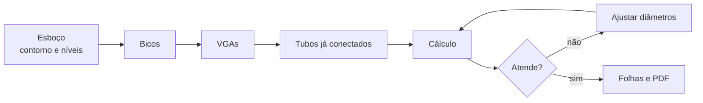

# Plano — do esboço às folhas

Como sair de um contorno no Revit (cobertura, forro, níveis) e chegar nas plantas do projeto, com a rede já ligada e o cálculo do motor SPK no meio. Cada etapa tem um critério de pronto para ir marcando.

As pranchas de referência são as do Mercantil Nova Era: setorização (009), sprinklers da cobertura (010), sprinklers do forro (011), detalhes e cortes da VGA (012), isométrico (013) e planta com isométrico de uma VGA (014).

Normas citadas por item, sem reproduzir texto. O motor e o que ele já acertou estão em [motor-prototipo.md](motor-prototipo.md).

## O que já está feito

- [x] Motor hidráulico (Hazen-Williams, árvore, grelha, área mais desfavorável, ESFR de 12 bicos).
- [x] Conferência com o memorial Sprinkler-CALC da Nova Era, fora do Revit: 12 bicos ESFR K 360, pressão nó a nó até 0,01 bar, vazão dos doze 0,4 % acima.
- [x] Add-in no Revit 2027, aba SPK: descobrir famílias, confirmar fator K e área, calcular a rede lida, abrir o memorial.
- [x] Amostragem no modelo da Nova Era: o bico crítico saiu a 2,83 bar e 606 L/min, coerente com K 360 na pressão mínima do memorial.

## O que essa amostragem não fecha

O arquivo da Nova Era tem os bicos desenhados sem o conector ligado ao tubo. A leitura só conseguiu juntar 8 bicos e 11 tubos. A área do ESFR pede 12 bicos em 3 ramais, então o comando calculou 4. A pressão na fonte (7,55 bar) não se compara aos 14,50 bar do memorial.

Gerar a rede pelo plugin evita esse buraco: cada tubo nasce de um conector ao seguinte, com cotovelo e tê. A planta deixa de ser geometria solta.

## Fluxo na faixa de opções

Os botões de descobrir famílias, calcular rede, exemplo e abrir memorial serviram para provar o motor dentro do Revit. Não são o fluxo de quem parte de um esboço.

O uso fica nesta ordem:

1. **Dados do esboço.** Classe, K em L/min/bar½, área em m², pressão mínima, C do tubo, espaçamento e altura. Uma janela.
2. **Gerar.** Bicos, VGAs e tubos já conectados.
3. **Calcular.** A rede que acabou de ser gerada. Se não atender, a lista diz o item.
4. **Resultados.** Memorial desse cálculo e, depois, as folhas.

| Projeto | Rede | Resultados |
|---|---|---|
| Dados do esboço | Rede de exemplo, Gerar | Memorial, Folhas |
| Famílias, menor | Calcular | |

**Rede de exemplo** cria os 12 bicos no ponto zero, apaga a malha marcada antes e abre a planta e o 3D já enquadrados. É a base para as folhas. **Gerar** continua para escolher o ponto e os dados da janela.

**Famílias** continua no painel Projeto, menor que os dados do esboço. Serve para um modelo que já veio desenhado, como a Nova Era. Não entra no caminho do esboço.

**Exemplo** sai da faixa principal. Fica num menu Avançado, para não parecer um passo do projetista. Calcula o galpão fictício e não lê o arquivo aberto.

A malha mínima (etapa 1) já nasce com Dados, Gerar e Calcular nessa ordem.

## Ordem

Não montar folha antes de uma malha pequena passar no cálculo. Folha em cima de tubo solto repete o erro da amostragem.

## 1. Malha mínima conectada

Um retângulo só, sem o prédio da Nova Era. Serve para provar o caminho inteiro.

Entrada: um contorno retangular num nível, altura da rede, fator K, área de cobertura, pressão mínima e um ponto de fonte.

- [x] Faixa na ordem Dados do esboço, Rede de exemplo, Gerar, Calcular, Memorial. Famílias no painel Projeto. O cálculo do galpão fictício fica no menu Avançado.
- [x] Botão Rede de exemplo: malha no ponto zero, vistas "SPK — Planta exemplo" e "SPK — Rede exemplo", tubos e sprinklers visíveis, 3D enquadrado.
- [ ] Colocar os bicos num grid, com o espaçamento da janela, usando uma família de sprinkler já carregada no projeto.
- [ ] Criar ramais, uma subgeral e um trecho até a fonte com `Pipe.Create` entre conectores.
- [ ] Inserir cotovelo e tê nos encontros, também por conector.
- [ ] Conferir no próprio modelo que cada bico tem sistema de tubulação preenchido.
- [ ] Rodar o motor nessa rede, sem aproximação por distância.
- [ ] A área de operação acha 12 bicos, 4 em cada um de 3 ramais, quando o grid for grande o bastante para isso.

Pronto quando o comando de calcular a rede não precisa encostar bico em tubo por proximidade, e o aviso de "bicos fora da rede" fica em zero.

## 2. Esboço de verdade

O contorno deixa de ser um retângulo digitado e passa a vir do modelo.

- [ ] Ler o contorno da cobertura e o do forro (piso, telhado ou ambiente fechado). Ignorar contorno aberto.
- [ ] Dois planos independentes: bico de telhado e bico de forro não caem no mesmo setor sem regra explícita.
- [ ] Respeitar afastamento de parede e espaçamento máximo. A primeira versão não desvia de viga nem de terça.
- [ ] Parâmetros do esboço numa janela: classe, K em L/min/bar½, área em m², pressão mínima, C do tubo. K americano (5,6) não entra direto. A tela mostra a unidade, como na confirmação de famílias.

Pronto quando um galpão retangular simples, desenhado no Revit, recebe os bicos sem editar coordenada à mão.

## 3. Setorização em VGAs

- [ ] Dividir a área pelo limite da Tabela 8 (coluna por pavimento).
- [ ] Cortar de preferência numa linha de estrutura, quando houver pilar ou viga no caminho.
- [ ] Um sistema de tubulação por VGA, com nome visível no Revit.
- [ ] A fonte de cada setor é a VGA, não a ponta de tubo mais baixa.

Pronto quando dois retângulos grandes viram dois sistemas, e o cálculo de um não mistura bico do outro.

## 4. Traçado

Espinha de peixe primeiro. Grelha fica para depois.

- [ ] Ramal na fila de bicos, subgeral cruzando os ramais, geral até a VGA.
- [ ] Diâmetro inicial único e conhecido (um DN informado na janela), para o cálculo ter diâmetro interno real.
- [ ] Comprimento equivalente das conexões criadas entra no trecho. Sem isso a pressão na fonte sai baixa, como na amostragem.
- [ ] C do tubo vem da janela. O padrão de ensaio é 120.

Pronto quando a rede gerada, lida de volta pelos conectores, reproduz o grafo que o gerador acabou de criar: mesmo número de bicos, de tubos e de ramais.

## 5. Cálculo em cima do que foi gerado

O motor não muda. Muda só a origem da rede.

- [ ] Busca da área mais desfavorável na rede gerada.
- [ ] Se não atender, a lista de verificações diz o item. A primeira versão não muda diâmetro sozinha.
- [ ] Resultados gravados no modelo: pressão e vazão no bico, pressão, vazão e velocidade no tubo.
- [ ] Memorial `.docx` do setor, o mesmo gerador de hoje.

Pronto quando uma malha gerada de 12 bicos ESFR K 360, com pressão mínima 2,83 bar, entrega o bico crítico nessa pressão e a vazão de um bico perto de 603 a 606 L/min. A vazão dos doze fica na ordem de 7 500 L/min. A pressão na fonte depende dos diâmetros e dos comprimentos equivalentes. Ela não precisa bater 14,50 bar enquanto o traçado não for o da Nova Era.

## 6. Folhas

Só depois do critério da etapa 5. O carimbo é o da família que o escritório já usa. O plugin não desenha o carimbo.

| Folha | O que o plugin cria | Depende de |
|---|---|---|
| Cobertura e forro | Vista de planta por nível, filtros por pressão, etiquetas de diâmetro, vazão e pressão, retângulo da área crítica | Etapa 5 gravada no modelo |
| Setorização | Planta colorida por sistema de tubulação, uma cor por VGA | Etapa 3 |
| Isométrico | Vista 3D só com os tubos e bicos do setor, diâmetro e comprimento do cálculo | Etapa 4 |
| Corte da VGA | Corte no ponto da válvula | Etapa 3 |
| Detalhe típico | Instância do detalhe do escritório, colocado na folha | Família já carregada |
| PDF | Exportar as folhas criadas | As vistas acima |

O botão Folhas, no painel Resultados, lê a malha marcada `SPK-GERADO`:

- SPK-010, planta do setor, com o retângulo em volta dos bicos e o bico crítico em vermelho quando o último cálculo for dessa malha.
- SPK-013, isométrico enquadrado na malha.
- SPK-012, corte olhando no sentido dos ramais, para a descida aparecer de perfil.
- PDF `SPK-folhas.pdf` na pasta `SPK` ao lado do arquivo. Se o projeto não foi salvo, o PDF vai para a pasta temporária do cálculo.

O carimbo é o da família já carregada no projeto. A setorização (009) espera mais de uma VGA. O detalhe típico da válvula continua sendo a família do escritório: o plugin ainda não posiciona esse bloco.

- [ ] Uma folha de planta do setor, com o retângulo da área crítica.
- [ ] Uma folha de isométrico do mesmo setor.
- [ ] Uma folha de setorização, quando houver mais de uma VGA.
- [ ] PDF dessas folhas numa pasta do projeto.

## 7. Dimensionar

Fora da primeira entrega. Entra quando o traçado conectado e as folhas de um setor já existem.

- [ ] Subir diâmetros até todas as verificações atenderem, com a ordem de DN que o projetista usar.
- [ ] Sugerir o ponto da bomba a partir da curva de abastecimento informada.

## Fora deste plano

- Ler a Nova Era antiga até os 715 bicos virarem uma rede só. O arquivo não tem o conector ligado. A validação do motor dessa obra continua sendo o `nova-era.json`.
- Grelha como traçado gerado.
- Desvio de viga, terça e obstáculo.
- Bico de forro e bico de telhado somados na mesma área.
- SINAPI.
- Várias ITs estaduais. A primeira setorização usa a Tabela 8 já codificada e a regra ESFR já usada no memorial (12 bicos, 4 por ramal, pressão mínima informada).

## Como marcar

A etapa em curso é a **1. Malha mínima conectada**. As outras não começam antes do critério de pronto da anterior. Ao fechar uma etapa, trocar `[ ]` por `[x]` neste arquivo.
